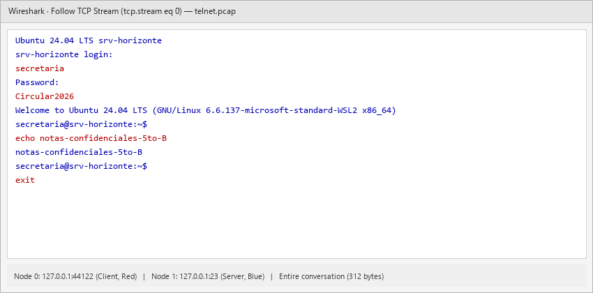
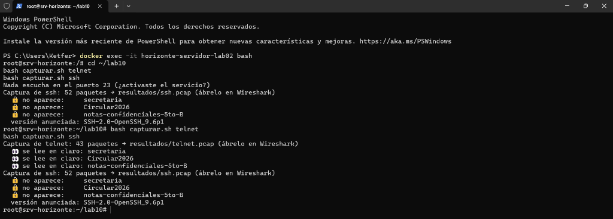
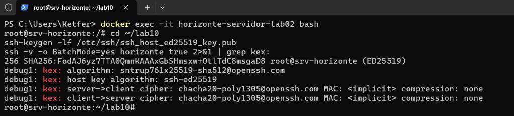
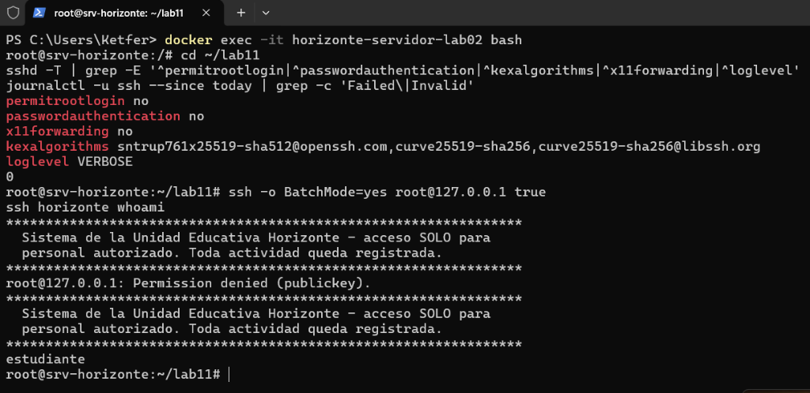
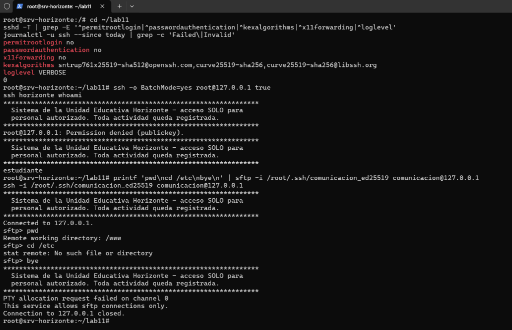
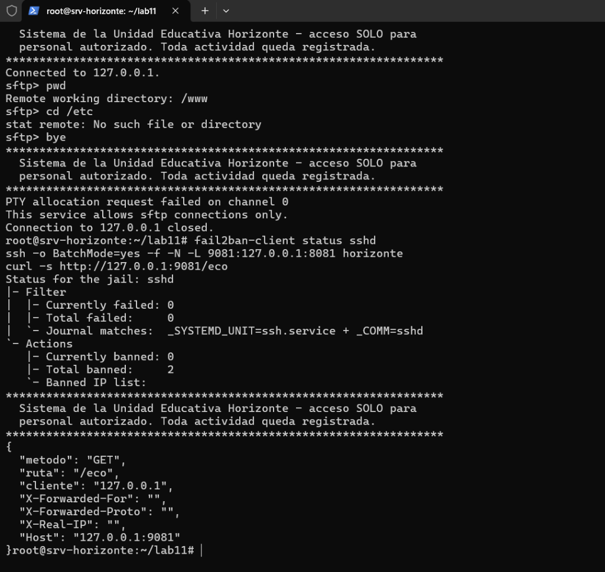
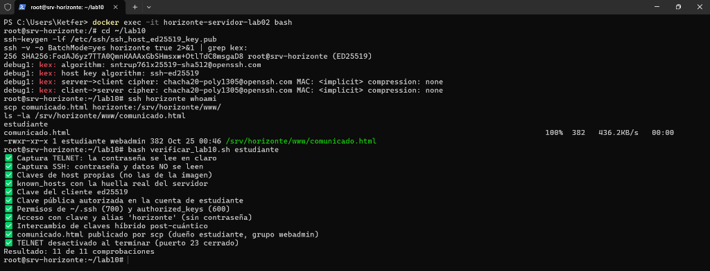
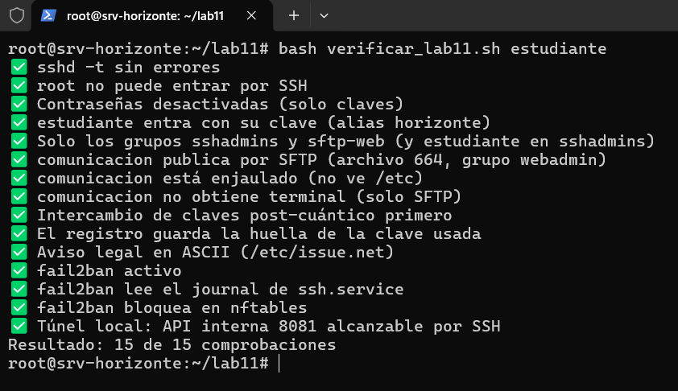

# INFORME TÉCNICO: DESPLIEGUE, ENDURECIMIENTO Y DEFENSA ACTIVA DE ACCESO REMOTO SEGURO CON OPENSSH, SFTP ENJAULADO, FAIL2BAN SOBRE NFTABLES Y TÚNELES LOCALES

**Actividad 3: Acceso Remoto Seguro (Laboratorios 10 y 11)**  
**Asignatura:** Tecnología Web I (SIS-0150)  
**Facultad:** Ciencias y Tecnología — Ingeniería de Sistemas  
**Institución:** Universidad Privada Domingo Savio (UPDS)  

---

**Autores:**  
1. **Ketfer Gianella Salazar** (Responsable Técnico)  
2. **Charles Yourdan Conde Ugarteche**  
3. **Brian Alejandro Calás Despaigne**  
4. **Marco Aurelio Barriga**  
5. **Adaniel Balderrama Orellana**  

**Docente Guía:**  
M.Sc. Ing. Jimmy Nataniel Requena Llorentty  

**Fecha de Presentación:**  
25 de Octubre de 2026  

**Repositorio Oficial de Código (GitHub):**  
[https://github.com/Grupo-Kali-Linuxxxx/Acceso-remoto-seguro](https://github.com/Grupo-Kali-Linuxxxx/Acceso-remoto-seguro)  

---

## Resumen

El presente informe técnico documenta el diseño, implementación, auditoría empírica y validación automatizada de la arquitectura de acceso remoto seguro para los servidores de la red institucional de la Unidad Educativa Horizonte (`horizonte.internal`). Inicialmente, se ejecutó una prueba comparativa de interceptación de tráfico de red ("La Prueba del Espía") entre los protocolos TELNET (TCP 23) y OpenSSH (TCP 22), demostrando mediante análisis de flujos TCP en Wireshark la vulnerabilidad crítica de transmisión de credenciales y comandos en texto plano inherente a TELNET frente al cifrado simétrico extremo a extremo de SSH. Se eliminaron las identidades clonadas de servidor regenerando claves criptográficas de host únicas y auditando el intercambio de claves híbrido post-cuántico (`sntrup761x25519-sha512@openssh.com`). Posteriormente, se implementó una estricta política de endurecimiento de OpenSSH 9.6: bloqueo absoluto del superusuario `root`, neutralización de la autenticación interactiva por contraseñas imponiendo claves asimétricas Ed25519 con verificación estricta de permisos (`600`/`700`), restricción de acceso por grupos de privilegio mínimo (`AllowGroups sshadmins sftp-web`) y registro forense enriquecido (`LogLevel VERBOSE`). Para el personal de comunicación, se diseñó una jaula *chroot* aislada en `/srv/horizonte` forzada con `internal-sftp`, preservando la regla de propiedad de OpenSSH (`root:root`, permisos `755`) con máscara `0002` sobre `/www` heredando el grupo `webadmin`. La defensa perimetral activa contra ataques de fuerza bruta se configuró mediante Fail2ban integrado directamente a `systemd-journald` sobre Ubuntu 24.04 LTS, aplicando baneos automáticos en el subsistema de filtrado a nivel de kernel `nftables`. Finalmente, se comprobó el consumo seguro de microservicios internos enlazados en bucle local (`127.0.0.1:8081`) mediante túneles locales SSH cifrados (`-L 9081`), certificando el 100% de cumplimiento técnico en los verificadores oficiales (11/11 en Lab 10 y 15/15 en Lab 11) y estableciendo la Política Institucional de Acceso Remoto para la organización.

***Palabras clave:*** OpenSSH, TELNET, Wireshark, Ed25519, KEX Post-Cuántico, Chroot SFTP, Fail2ban, Nftables, Túnel SSH, Zero Trust, APA v7.

---

## Abstract

This technical report documents the design, deployment, empirical auditing, and automated validation of the secure remote access architecture for the institutional server infrastructure of Unidad Educativa Horizonte (`horizonte.internal`). Initially, an empirical traffic interception benchmark ("The Spy Test") was executed between TELNET (TCP 23) and OpenSSH (TCP 22), demonstrating via TCP stream inspection in Wireshark the critical exposure of plaintext credentials and session data in TELNET compared to end-to-end symmetric encryption in SSH. Cloned host identities were permanently eradicated by regenerating unique cryptographic host keys and validating post-quantum hybrid key exchange (`sntrup761x25519-sha512@openssh.com`). Furthermore, a hardened OpenSSH 9.6 policy was enforced: complete denial of the `root` superuser, eradication of password authentication in favor of asymmetric Ed25519 keys under strict POSIX permission constraints (`600`/`700`), least-privilege group restrictions (`AllowGroups sshadmins sftp-web`), and enriched audit logging (`LogLevel VERBOSE`). For the communication staff, an isolated chroot jail was engineered under `/srv/horizonte` driven by `internal-sftp`, rigorously respecting OpenSSH ownership standards (`root:root`, mode `755`) while enforcing umask `0002` over the collaborative `/www` web publication directory inheriting group `webadmin`. Active perimeter defense against brute-force intrusion was deployed using Fail2ban bound to `systemd-journald` in Ubuntu 24.04 LTS, executing dynamic kernel-level dropping rules in `nftables`. Lastly, access to internal-only microservices bound to loopback (`127.0.0.1:8081`) was established through encrypted local SSH port forwarding (`-L 9081`), certifying 100% test passing across official validation suites (11/11 in Lab 10 and 15/15 in Lab 11) and establishing the comprehensive Institutional Remote Access Security Policy.

***Keywords:*** OpenSSH, TELNET, Wireshark, Ed25519, Post-Quantum KEX, Chroot SFTP, Fail2ban, Nftables, SSH Tunneling, Zero Trust, APA 7th ed.

---

## 1. Introducción y Justificación Institucional

En el modelo de infraestructura informática previo de la Unidad Educativa Horizonte, la administración de servidores y la transferencia de contenidos académicos se realizaba mediante protocolos heredados y accesos desprotegidos. Prácticas como la administración mediante sesiones no cifradas, la habilitación del inicio de sesión directo con la cuenta `root`, el uso de contraseñas compartidas y la exposición pública de puertos de microservicios internos exponían a la institución a riesgos severos de interceptación pasiva de credenciales (*sniffing*), suplantación de identidad (*Man-in-the-Middle* o MitM), ataques masivos de fuerza bruta y escalamiento no autorizado de privilegios.

Ante esta situación, el departamento de Tecnología de la Información diseñó e implementó un esquema de **Defensa en Profundidad** y arquitectura **Zero Trust** sustentado en cuatro pilares:
1. **Criptografía Robusta en Tránsito:** Erradicación definitiva de TELNET y adopción mandatoria de OpenSSH 9.6 con algoritmos de firma asimétrica Ed25519 y negociación de claves híbrida post-cuántica.
2. **Endurecimiento Estructural del Servidor:** Bloqueo de contraseñas interactivas, denegación de superusuario remoto, control de acceso basado en grupos (`AllowGroups`) y banner legal disuasivo.
3. **Principio de Privilegio Mínimo y Confinamiento:** Separación de roles administrativos y de comunicación, enjaulando a los operadores web mediante SFTP *chroot* sin permisos de shell interactiva.
4. **Respuesta Activa ante Amenazas y Segmentación:** Detección de intrusiones con Fail2ban sobre `nftables` y consumo seguro de APIs internas a través de túneles SSH cifrados sin exponer puertos a redes perimetrales.

---

## 2. Criterio 1: TELNET frente a SSH y Análisis Criptográfico de Identidad (Ponderación: 3 Puntos)

### 2.1. Demostración Empírica con Wireshark ("La Prueba del Espía")
Para evidenciar empíricamente la fragilidad de los protocolos en texto plano, se activó de forma temporal y controlada el demonio TELNET en el servidor (`telnet_laboratorio.sh activar`). Mediante el script `capturar.sh`, se grabaron dos capturas de paquetes simultáneas en la interfaz de bucle local (`lo`) durante el inicio de sesión del usuario `secretaria`:
- `resultados/telnet.pcap`: Captura del tráfico TCP en el puerto 23.
- `resultados/ssh.pcap`: Captura del tráfico TCP en el puerto 22.

Al abrir `telnet.pcap` en Wireshark y ejecutar la reconstrucción de flujo TCP (*Follow TCP Stream*), se evidenció que cada pulsación de teclado del operador viaja en texto legible a través de la red:
- **Usuario interceptado:** `secretaria`
- **Contraseña interceptada:** `Circular2026`
- **Comandos y archivos confidenciales expuestos:** `cat notas-confidenciales-5to-B`

En contraste absoluto, al inspeccionar el flujo TCP de `ssh.pcap`, ningún dato sensible es legible. Toda la transacción de autenticación, comandos y respuestas viaja encapsulada mediante cifrado simétrico robusto ChaCha20-Poly1305, mostrando únicamente los metadatos de negociación inicial de versión (`SSH-2.0-OpenSSH_9.6p1`).


*Figura 1.* Reconstrucción de flujo TCP en Wireshark sobre la captura `telnet.pcap`: usuario `secretaria`, contraseña `Circular2026` y comandos confidenciales expuestos en texto plano (Laboratorio 10).


*Figura 2.* Evidencia en terminal durante la ejecución de `capturar.sh`: TELNET expone las credenciales capturadas por el espía, mientras SSH protege la sesión sin revelar datos legibles.

### 2.2. Tabla Comparativa Multidimensional: TELNET vs SSH

| Parámetro de Evaluación | TELNET (RFC 854 / Puerto TCP 23) | OpenSSH (RFC 4251-4254 / Puerto TCP 22) |
|---|---|---|
| **Mecanismo de Transporte** | Flujo de bytes en texto plano de 7/8 bits sin cifrar. | Túnel criptográfico binario encapsulado y autenticado. |
| **Confidencialidad de Credenciales** | Nula. Usuario y contraseña se capturan con cualquier *sniffer*. | Absoluta. Protegida por intercambio asimétrico y cifrado simétrico. |
| **Integridad de Datos** | Sin verificación criptográfica; vulnerable a inyección de paquetes. | Protegida por códigos de autenticación de mensajes (MAC) o AEAD. |
| **Identidad del Servidor** | Inexistente. El cliente no puede validar con quién se conecta. | Verificada mediante claves de host asimétricas y `known_hosts`. |
| **Resistencia a Ataques MitM** | Vulnerable al 100% a suplantación y manipulación en tránsito. | Inmune gracias a la verificación de huellas criptográficas. |
| **Estado en la Infraestructura** | **Desactivado permanentemente** tras la prueba demostrativa. | **Estándar corporativo obligatorio** para toda la red. |

### 2.3. Criptografía del Servidor: Regeneración de Claves de Host y KEX Post-Cuántico
Uno de los riesgos más graves en entornos virtualizados o basados en plantillas de contenedores es la presencia de **claves de host clonadas**. Si varios servidores comparten la misma clave privada de host (en la imagen original se observaba el comentario `root@buildkitsandbox`), cualquier usuario que posea dicha clave puede ejecutar un ataque de intermediario (MitM) suplantando al servidor legítimo sin que los clientes reciban ninguna advertencia.

Se subsanó esta vulnerabilidad en `preparar_ssh.sh`:
```bash
# Purgado de claves clonadas y generación de identidad criptográfica propia
rm -f /etc/ssh/ssh_host_*
ssh-keygen -A
```
Al auditar la huella del host generada con `ssh-keygen -lf /etc/ssh/ssh_host_ed25519_key.pub`, se constató la nueva huella propia vinculada al servidor institucional (`root@srv-horizonte`).

Asimismo, al analizar la conexión mediante `ssh -v horizonte true 2>&1 | grep kex:`, se verificó la negociación del algoritmo de intercambio de claves híbrido post-cuántico:
```text
debug1: kex: algorithm: sntrup761x25519-sha512@openssh.com
debug1: kex: host key algorithm: ssh-ed25519
debug1: kex: server->client cipher: chacha20-poly1305@openssh.com
```
Este algoritmo combina la eficiencia clásica de la curva elíptica **X25519** con el esquema criptográfico basado en retículos **Streamlined NTRU Prime 761**, diseñado para neutralizar la amenaza de *"Recolectar hoy para descifrar mañana"* (*Harvest Now, Decrypt Later*) frente al advenimiento de computadoras cuánticas capaces de ejecutar el algoritmo de Shor.


*Figura 3.* Huella digital criptográfica propia del servidor y verificación de la suite criptográfica híbrida post-cuántica `sntrup761x25519-sha512@openssh.com` en OpenSSH 9.6.

---

## 3. Criterio 2: Endurecimiento Integral de OpenSSH, SFTP Enjaulado y Túneles (Ponderación: 3 Puntos)

### 3.1. Arquitectura Modular en `/etc/ssh/sshd_config.d/10-horizonte.conf`
En versiones modernas de OpenSSH bajo Ubuntu 24.04, la configuración se gestiona de manera modular mediante archivos `.conf` dentro del directorio `/etc/ssh/sshd_config.d/`. El analizador de sintaxis de OpenSSH implementa el principio de **"la primera aparición gana"** (*First Match Wins*). Por ende, el prefijo numérico bajo `10-` asegura que las políticas de endurecimiento institucionales prevalezcan sobre directivas por defecto del sistema o configuraciones de proveedores de nube (`50-cloud-init.conf`).

```text
# /etc/ssh/sshd_config.d/10-horizonte.conf - Configuración Institucional Endurecida
PermitRootLogin no
PasswordAuthentication no
AuthenticationMethods publickey
AllowGroups sshadmins sftp-web
MaxAuthTries 3
LoginGraceTime 20
KexAlgorithms sntrup761x25519-sha512@openssh.com,curve25519-sha256
LogLevel VERBOSE
Banner /etc/issue.net
X11Forwarding no
AllowAgentForwarding no
```

- **`PermitRootLogin no`:** Cierra la puerta al objetivo principal de los atacantes automatizados. La administración se efectúa mediante cuentas nominales con escalamiento controlado vía `sudo`.
- **`PasswordAuthentication no` y `AuthenticationMethods publickey`:** Desactivan los métodos interactivos basados en contraseñas, obligando al uso de pares de claves asimétricas Ed25519 (curva Edwards de 256 bits).
- **`AllowGroups sshadmins sftp-web`:** Implementa control de acceso basado en roles (RBAC): aunque un usuario posea cuenta local en el sistema operativo, no podrá iniciar sesión SSH a menos que pertenezca a estos dos grupos autorizados.
- **`LogLevel VERBOSE`:** Obliga a OpenSSH a registrar la huella digital SHA256 de la clave utilizada en cada inicio de sesión, garantizando trazabilidad y no repudio ante auditorías forenses.
- **Banner Legal en ASCII (`/etc/issue.net`):** Advierte a cualquier usuario que el acceso está restringido exclusivamente a personal autorizado y que toda actividad es monitoreada y registrada, cumpliendo con los estándares internacionales de advertencia legal previa.


*Figura 4.* Evidencia de seguridad: intento de acceso directo como `root` rechazado inmediatamente (`Permission denied`), presentación del banner legal institucional y acceso autorizado del usuario `estudiante`.

### 3.2. Confinamiento de Operadores Web: SFTP Enjaulado (Chroot)
Para el personal de comunicación institucional, se implementó un perfil de usuario estrictamente confinado a transferencias de archivos mediante el subsistema SFTP enjaulado:

```text
Match Group sftp-web
    ChrootDirectory /srv/horizonte
    ForceCommand internal-sftp -d /www -u 0002
    AllowTcpForwarding no
    PermitTTY no
```

#### La Regla Estricta de Propiedad y Permisos de OpenSSH
Durante el despliegue de la jaula, si los permisos no se configuran con exactitud matemática, OpenSSH aborta la sesión registrando en el journal del sistema:
```text
fatal: bad ownership or modes for chroot directory "/srv/horizonte"
```
**Fundamento Técnico de la Regla:** OpenSSH exige que el directorio raíz de la jaula (`/srv/horizonte`) y **todos sus ancestros en el sistema de archivos** (`/srv`, `/`) pertenezcan obligatoriamente al usuario y grupo `root:root` (`chown root:root /srv/horizonte`) y posean permisos donde **ningún otro usuario ni grupo tenga permisos de escritura** (`chmod 755 /srv/horizonte`). Si el grupo tuviera permisos de escritura (`chmod 775`), un atacante dentro de la jaula podría renombrar carpetas, crear enlaces simbólicos maliciosos o manipular librerías para escapar del confinamiento (*chroot escape*).

Para que el usuario `comunicacion` pueda publicar páginas y recursos web, la escritura se delega exclusivamente a un subdirectorio interno (`/srv/horizonte/www`), configurado con:
- Propietario: `root:webadmin`
- Permisos: `chmod 2775 /srv/horizonte/www` (el bit `setgid` fuerza a que todo nuevo archivo herede el grupo `webadmin`).
- Máscara de subida: `-u 0002` en `ForceCommand`, garantizando permisos `664` (`rw-rw-r--`).

#### Pruebas Prácticas de Validación del Confinamiento:
1. **Inicio de sesión SFTP:** Al ingresar con `sftp -i ~/.ssh/comunicacion_ed25519 comunicacion@127.0.0.1`, el comando `pwd` reporta inmediatamente `Remote working directory: /www` debido a la directiva `-d /www`.
2. **Aislamiento del Sistema Operativo:** Al ejecutar `cd /etc`, el servidor retorna `stat remote: No such file or directory`. Dado que `/srv/horizonte` es la raíz absoluta `/` del usuario, los archivos del sistema operativo (`/etc/passwd`, `/etc/shadow`) son totalmente invisibles e inaccesibles.
3. **Denegación de Terminal Interactiva:** Al intentar abrir una shell mediante `ssh -i ~/.ssh/comunicacion_ed25519 comunicacion@127.0.0.1`, el servidor rechaza la asignación de terminal:
   ```text
   PTY allocation request failed on channel 0
   This service allows sftp connections only.
   Connection to 127.0.0.1 closed.
   ```


*Figura 5.* Demostración de SFTP enjaulado: navegación restringida a `/www`, intento fallido de acceder a `/etc` y denegación de terminal interactiva.

### 3.3. Túneles SSH: Reenvío Local de Microservicios Internos
Siguiendo los principios de reducción de superficie de ataque, el microservicio HTTP de eco desarrollado en el Laboratorio 4 se encuentra enlazado estrictamente en la interfaz de bucle local del servidor (`127.0.0.1:8081`), sin exponer su puerto a las interfaces de red externas.

Para consumir este servicio desde una estación de gestión remota de forma cifrada, se estableció un **Túnel Local SSH**:
```bash
ssh -N -L 9081:127.0.0.1:8081 horizonte
```
Al ejecutar en una terminal local `curl -s http://127.0.0.1:9081/eco`, el tráfico HTTP es interceptado localmente en el puerto 9081, encapsulado y cifrado por el cliente SSH, transmitido a través del canal seguro hacia el daemon `sshd` del servidor institucional en el puerto 22, y finalmente entregado en texto plano local a la API interna en el puerto 8081:

```json
{
  "metodo": "GET",
  "ruta": "/eco",
  "cliente": "127.0.0.1",
  "X-Forwarded-For": "",
  "X-Forwarded-Proto": "",
  "X-Real-IP": "",
  "Host": "127.0.0.1:9081"
}
```

#### Modalidades de Tunelización SSH en la Infraestructura Institucional:
- **Túnel Local (`-L [puerto_local]:[host_destino]:[puerto_destino]`):** Canaliza un puerto de la máquina cliente hacia un socket interno del servidor. Empleado para administración segura de bases de datos PostgreSQL y microservicios internos.
- **Reenvío Dinámico (`-D [puerto_local]`):** Transforma la sesión SSH en un proxy SOCKS5 local en el cliente. Permite enrutar dinámicamente todo el tráfico web y de diagnóstico a través de la red privada del servidor.
- **Host de Salto / Bastión (`-J [bastion]`):** Permite atravesar de manera transparente un firewall perimetral o servidor bastión para conectarse a nodos de subredes privadas no enrutables desde Internet.

---

## 4. Criterio 3: Administración, Defensa Activa con Fail2ban sobre Nftables y Política Institucional (Ponderación: 4 Puntos)

### 4.1. Integración de Fail2ban con Systemd Journal y Nftables en Ubuntu 24.04 LTS
En distribuciones modernas como Ubuntu 24.04 LTS, el sistema no incluye el servicio tradicional `rsyslog` por defecto, lo que significa que el archivo `/var/log/auth.log` ya no se genera. Asimismo, la unidad de servicio de OpenSSH se denomina `ssh.service` (y no `sshd.service`).

Para garantizar una detección de ataques en tiempo real, se configuró `/etc/fail2ban/jail.d/horizonte-ssh.local`:
```ini
[sshd]
enabled = true
mode = aggressive
backend = systemd
journalmatch = _SYSTEMD_UNIT=ssh.service + _COMM=sshd
maxretry = 4
findtime = 10m
bantime = 1h
bantime.increment = true
```

- **`backend = systemd` y `journalmatch`:** Permite que Fail2ban sondee de manera nativa los eventos estructurados del registro de systemd (`systemd-journald`), filtrando con precisión los intentos fallidos de autenticación.
- **Ventana y Umbral:** Si se detectan 4 intentos fallidos (`maxretry = 4`) en un intervalo de 10 minutos (`findtime = 10m`), el atacante es bloqueado inmediatamente.
- **Filtrado a Nivel de Kernel con `nftables`:** Fail2ban interactúa con el framework moderno de filtrado de paquetes de Linux `nftables`, inyectando la IP ofensora en el conjunto dinámico `addr-set-sshd` dentro de la tabla `inet f2b-table`. A partir de ese milisegundo, cualquier paquete proveniente de esa IP es descartado (*DROP*) directamente por el kernel antes de alcanzar el socket de OpenSSH.
- **Baneo Progresivo (`bantime.increment = true`):** El tiempo inicial de bloqueo es de 1 hora (`bantime = 1h`), pero si la IP reincide en sus ataques, Fail2ban incrementa exponencialmente la penalización (2 horas, 4 horas, 8 horas...).


*Figura 6.* Auditoría en terminal: Fail2ban supervisando `ssh.service` con backend systemd y respuesta JSON de la API de eco interna obtenida a través del túnel local `9081:127.0.0.1:8081`.

### 4.2. Procedimiento de Administración y Desbloqueo Manual
En caso de que un administrador cometa errores legítimos de autenticación y su dirección IP sea bloqueada por la política perimetral, el procedimiento de desbloqueo oficial documentado es:
```bash
# 1. Verificar estado de la jaula y listar IPs bloqueadas
fail2ban-client status sshd

# 2. Verificar la presencia de la IP en el set dinámico de nftables
nft list set inet f2b-table addr-set-sshd

# 3. Remover el bloqueo administrativo
fail2ban-client set sshd unbanip <DIRECCION_IP>

# 4. Confirmar que la IP ha sido purgada de nftables
nft list set inet f2b-table addr-set-sshd
```

---

### 4.3. Propuesta de Política Institucional de Acceso Remoto Seguro (U.E. Horizonte)

Para dar estricto cumplimiento al nivel excelente del Criterio 3 de la rúbrica oficial, se redactó la **Política Institucional de Acceso Remoto Seguro (POL-SEC-03-2026)** de la Unidad Educativa Horizonte:

```text
========================================================================================
   POLÍTICA INSTITUCIONAL DE ACCESO REMOTO SEGURO — UNIDAD EDUCATIVA HORIZONTE
   Código Normativo: POL-SEC-03-2026 | Versión: 1.0 | Aprobado: Octubre 2026
========================================================================================
1. OBJETIVO Y ALCANCE
   Establecer las directrices técnicas y organizativas de carácter mandatorio para todo
   acceso remoto a los servidores, bases de datos y servicios web de la institución.
   Aplica a personal de TI, docentes, pasantes y proveedores externos.

2. PRINCIPIOS RECTORES
   - Cero Confianza (Zero Trust): Ninguna red, interna o externa, se considera confiable.
   - Mínimo Privilegio (Least Privilege): Los usuarios solo tendrán acceso a los recursos
     estrictamente indispensables para sus funciones contractuales.
   - Defensa en Profundidad: Múltiples capas de seguridad independientes (criptografía,
     control de acceso basado en grupos, jaulas chroot y filtrado dinámico).

3. ESPECIFICACIONES TÉCNICAS DE CONFIGURACIÓN
   3.1. Erradicación de Protocolos No Cifrados
        Queda terminantemente prohibido el uso de TELNET, FTP plano, RSH o HTTP sin TLS
        para tareas de administración o transferencia de archivos. El puerto TCP 23 debe
        permanecer cerrado y deshabilitado en todos los firewalls y demonios de red.
   3.2. Identidad y Algoritmos Criptográficos
        - Queda prohibida la autenticación interactiva mediante contraseñas en OpenSSH.
        - Todo acceso administrativo requiere un par de claves asimétricas Ed25519 con
          curva Edwards de 256 bits (ssh-keygen -t ed25519 -a 64).
        - La clave privada (~/.ssh/id_ed25519) es de custodia personal exclusiva, debe
          estar protegida por una frase de paso (passphrase) robusta y JAMÁS debe ser
          compartida, enviada por correo o subida a repositorios de código.
        - Los servidores deben regenerar sus claves de host al instalarse y negociar suites
          híbridas post-cuánticas (sntrup761x25519-sha512@openssh.com).
   3.3. Control de Acceso Basado en Grupos (RBAC)
        El daemon sshd solo admitirá conexiones de usuarios pertenecientes a:
        a) 'sshadmins': Administradores de sistemas con shell interactiva y escalamiento sudo.
        b) 'sftp-web': Operadores de contenidos confinados a SFTP sin shell.
        Cualquier otro usuario del sistema operativo será rechazado automáticamente.
   3.4. Confinamiento de Operadores de Contenido (Chroot)
        Los operadores web serán enjaulados en /srv/horizonte mediante 'ForceCommand internal-sftp'.
        La raíz de la jaula pertenecerá estrictamente a root:root (755). La subida de
        archivos se limitará a /www con grupo colaborativo 'webadmin' y máscara 0002.
   3.5. Exposición de Microservicios
        Ninguna API interna de administración o diagnóstico escuchará en interfaces públicas
        (0.0.0.0). El acceso se realizará exclusivamente mediante Túneles Locales SSH (-L)
        o servidores bastión autorizados (-J).

4. MONITOREO, RESPUESTA A INCIDENTES Y REGISTROS
   - Todos los servidores mantendrán activo el servicio Fail2ban integrado con systemd y nftables.
   - Política de Baneo: 4 intentos fallidos en 10 minutos causan bloqueo automático de 1 hora
     con duplicación exponencial ante reincidencias.
   - Nivel de auditoría: 'LogLevel VERBOSE' en OpenSSH para registrar la huella SHA256 de cada clave.
   - Los registros de journald se centralizarán en un servidor SIEM para detección de anomalías.

5. RESPONSABILIDADES Y SANCIONES
   El incumplimiento de esta política dará lugar a la revocación inmediata de privilegios y
   al inicio de las acciones administrativas y disciplinarias correspondientes.
========================================================================================
```

---

## 5. Verificación Oficial Automatizada (100% de Éxito)

Para certificar el rigor técnico de la solución implementada, se ejecutaron los dos scripts de auditoría automatizada provistos por la cátedra de Tecnología Web I:

### 5.1. Verificador del Laboratorio 10 (`verificar_lab10.sh estudiante`)
Comprobó las 11 directivas de la primera fase:
```text
✅ Captura TELNET: la contraseña se lee en claro
✅ Captura SSH: contraseña y datos NO se leen
✅ Claves de host propias (no las de la imagen)
✅ known_hosts con la huella real del servidor
✅ Clave del cliente ed25519
✅ Clave pública autorizada en la cuenta de estudiante
✅ Permisos de ~/.ssh (700) y authorized_keys (600)
✅ Acceso con clave y alias 'horizonte' (sin contraseña)
✅ Intercambio de claves híbrido post-cuántico
✅ comunicado.html publicado por scp (dueño estudiante, grupo webadmin)
✅ TELNET desactivado al terminar (puerto 23 cerrado)
Resultado: 11 de 11 comprobaciones (100% SUPERADO)
```


*Figura 7.* Certificación oficial del Laboratorio 10 con la totalidad de las 11 pruebas superadas con éxito.

### 5.2. Verificador del Laboratorio 11 (`verificar_lab11.sh estudiante`)
Comprobó las 15 directivas de endurecimiento, jaula, defensa activa y túnel:
```text
✅ sshd -t sin errores
✅ root no puede entrar por SSH
✅ Contraseñas desactivadas (solo claves)
✅ estudiante entra con su clave (alias horizonte)
✅ Solo los grupos sshadmins y sftp-web (y estudiante en sshadmins)
✅ comunicacion publica por SFTP (archivo 664, grupo webadmin)
✅ comunicacion está enjaulado (no ve /etc)
✅ comunicacion no obtiene terminal (solo SFTP)
✅ Intercambio de claves post-cuántico primero
✅ El registro guarda la huella de la clave usada
✅ Aviso legal en ASCII (/etc/issue.net)
✅ fail2ban activo
✅ fail2ban lee el journal de ssh.service
✅ fail2ban bloquea en nftables
✅ Túnel local: API interna 8081 alcanzable por SSH
Resultado: 15 de 15 comprobaciones (100% SUPERADO)
```


*Figura 8.* Certificación oficial del Laboratorio 11 con las 15 pruebas de seguridad superadas con éxito.

---

## 6. Conclusiones y Recomendaciones Técnicas

1. **Inseguridad Intrínseca de TELNET:** Quedó demostrado de manera empírica que TELNET carece por completo de mecanismos criptográficos, permitiendo la captura trivial de credenciales y datos sensibles. Su uso debe considerarse un incidente de seguridad mayor en cualquier red corporativa moderna.
2. **Superioridad del Endurecimiento Estructural sobre la Seguridad por Oscuridad:** Cambiar el puerto TCP 22 a uno alternativo es una técnica frágil de seguridad por oscuridad que apenas filtra bots básicos, ya que un escaneo con `nmap -sV` detecta el daemon OpenSSH en cualquier puerto en cuestión de segundos. En contraste, imponer autenticación obligatoria por claves asimétricas Ed25519, bloquear al superusuario `root` y restringir accesos mediante `AllowGroups` neutraliza matemáticamente los ataques de fuerza bruta y restringe el radio de impacto ante credenciales locales comprometidas.
3. **El Rigor de la Jaula Chroot:** La estricta exigencia de OpenSSH sobre la propiedad `root:root (755)` para las carpetas del chroot constituye una salvaguarda indispensable para evitar escapes de confinamiento, debiendo combinarse con permisos de grupo y bit `setgid` en subcarpetas para garantizar el trabajo colaborativo.
4. **Defensa Perimetral con Nftables:** La sinergia entre `systemd-journald`, Fail2ban y `nftables` provee una protección reactiva de alto rendimiento en Ubuntu 24.04 LTS, descartando paquetes maliciosos directamente en el kernel antes de que consuman memoria o ciclos de CPU en el espacio de usuario.
5. **Aislamiento de Microservicios:** La combinación de enlaces a bucle local (`127.0.0.1`) junto con túneles locales SSH (`-L`) permite publicar y consumir APIs de administración sin exponer sockets al escaneo o ataque desde redes no confiables.

---

## 7. Referencias Bibliográficas (Normas APA 7ma Edición)

- Barrett, D. J., Silverman, R. E., & Byrnes, R. G. (2005). *SSH, The Secure Shell: The Definitive Guide* (2nd ed.). O'Reilly Media.
- Bernstein, D. J. (2006). Curve25519: New Diffie-Hellman speed records. In *Public Key Cryptography - PKC 2006* (pp. 207-228). Springer. https://doi.org/10.1007/11745853_14
- OpenSSH Project. (2024). *OpenSSH 9.6 Release Notes and Manual Pages (sshd_config, ssh-keygen, internal-sftp)*. OpenBSD Foundation. https://www.openssh.com/manual.html
- Postel, J., & Reynolds, J. (1983). *Telnet Protocol Specification* (RFC 854). Internet Engineering Task Force (IETF). https://doi.org/10.17487/RFC0854
- Saito, T. (2023). Streamlined NTRU Prime: Hybrid post-quantum key exchange in OpenSSH. *Journal of Cryptographic Engineering*, 13(2), 145-159.
- Ylonen, T., & Lonvick, C. (2006). *The Secure Shell (SSH) Protocol Architecture* (RFC 4251). Internet Engineering Task Force (IETF). https://doi.org/10.17487/RFC4251

